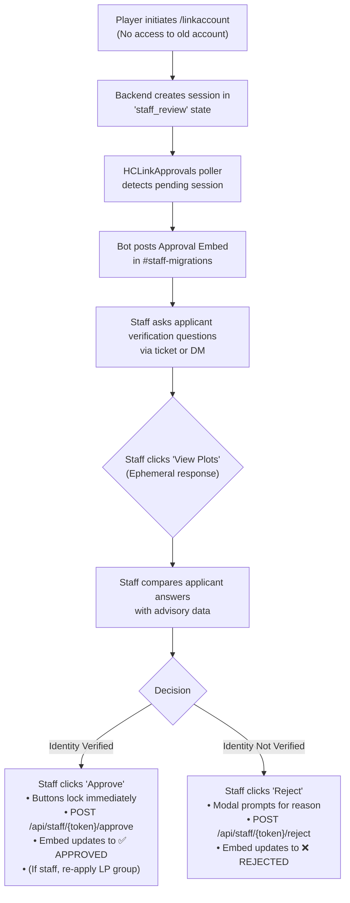

# HCLinkApprovals — Red-DiscordBot Cog (Phase 3)

The official Discord staff review cog for the **HC Account Migration System** on Naval Battlezone (`migrate.navalbattlezone.com:9443`).

This cog runs inside the existing **DabbleBot** Red-DiscordBot (v3.5+) instance. When a player cannot confirm their old Minecraft account in-game (entering the `staff_review` state), this cog surfaces their request in a designated staff channel, presents advisory verification data, and allows authorized staff to inspect player ships and Approve or Reject the migration via interactive Discord UI buttons.

---

## Architecture & Design

- **Framework**: Red-DiscordBot 3.5.24+, `discord.py` 2.7.1+, `aiohttp`.
- **Target Backend**: Migration API running at `https://migrate.navalbattlezone.com:9443`.
- **Authentication**: HMAC-SHA256 request signatures with timestamp replay protection (`X-HCLink-Signature` / `X-HCLink-Timestamp` & `X-HC-*`).
- **Data Persistence**: `redbot.core.Config` stores backend settings and a `message_id <-> session_token` mapping to prevent duplicate posts and track state transitions.
- **DabbleBot Convention**: This cog is strictly committed to the repository and loaded from there. **Never edit files directly on the live bot.**

---

## Installation & Setup

### 1. Add Cog Path to Red
On the DabbleBot instance, register the cog directory:
```
[p]cog addpath /home/keough99/hc-migration/cog
```

### 2. Load the Cog
```
[p]load HCLinkApprovals
```

### 3. Configure the Cog (`[p]hclinkset`)
Run the admin configuration commands:

```
# 1. Set backend base URL
[p]hclinkset backend https://migrate.navalbattlezone.com:9443

# 2. Set HMAC shared secret (prompts via DM so secret is never exposed in chat)
[p]hclinkset secret

# 3. Set the staff review channel where embeds will be posted
[p]hclinkset channel #staff-migrations

# 4. Set the staff role permitted to click View Plots / Approve / Reject
[p]hclinkset role @Staff

# 5. Set the polling interval (default 30 seconds; minimum 5s)
[p]hclinkset interval 30

# 6. Verify configuration (secrets are masked)
[p]hclinkset settings

# 7. Run backend diagnostic & permission check
[p]hclinkset test
```

---

## Staff Workflow Narrative



### 1. Embed Appears
When a player reaches `staff_review`, the background poller detects the session via `GET /api/staff/pending` and posts an embed with:
- **Old Account**: Username and UUID.
- **New Account**: Verified Microsoft/Xbox username and UUID.
- **Requested**: Request creation timestamp (relative and human-readable).
- **Plot / Ship Count**: Historical plot count from MariaDB `HC_MC`.
- **Last Played**: Formatted last online datetime.
- **Balance**: Current EconomySync synced balance (displays `"no balance on record"` if `None`).
- **Footer**: Request token prefix (`Request Token: <first 8 chars>`).

### 2. Advisory Verification (Conversational)
Staff members open a support ticket or DM with the applicant and ask the conversational questions listed in the embed description:
1. *"Roughly how much money did you have?"* (Compare against **Balance**; if "no balance on record", skip).
2. *"Roughly how many plots or ships did you own?"* (Compare against **Plot / Ship Count**).
3. *"Can you name one of your ships or plots?"* (Click **View Plots** to verify).
4. *"Approximately when did you last play on the server?"* (Compare against **Last Played**).

> [!NOTE]
> **Advisory Only**: There is no automated quiz or scoring. Verification is human-evaluated.

### 3. Interactive Buttons
- **View Plots** *(Gray Button)*:
  - Calls `GET /api/staff/{token}/plots`.
  - Responds **EPHEMERALLY** to the staff member with the complete list of ship and plot names in formatted code blocks.
  - Automatically splits into paginated followups if the list exceeds 2,000 characters.
- **Approve** *(Green Button)*:
  - Immediately disables all buttons while in-flight to prevent race conditions.
  - Sends `POST /api/staff/{token}/approve` with `{"discord_id": "<staff_id>"}`.
  - On success, edits the embed title to `✅ Account Migration Request — APPROVED`, adds an `Approved by <@staff>` field, and leaves buttons disabled.
  - *Staff account reminder*: If the player is a staff member, manual LuckPerms group re-assignment is required as noted in the embed.
- **Reject** *(Red Button)*:
  - Opens a Discord Modal allowing staff to enter an optional rejection reason.
  - Sends `POST /api/staff/{token}/reject` with `{"discord_id": "<staff_id>", "reason": "..."}`.
  - On success, edits embed to `❌ Account Migration Request — REJECTED` and records the reason.

### 4. Automatic Resolution
If a session is completed via the web portal or expires before staff action, the next poll cycle automatically updates the message embed to `⚪ Account Migration Request — RESOLVED` and disables the buttons.

---

## Security Model

1. **HMAC-SHA256 Canonical Signing**:
   - Every outbound API call is signed using `hmac.new(secret, f"{timestamp}:{body}".encode(), sha256).hexdigest()`.
   - Headers: `X-HCLink-Timestamp` and `X-HCLink-Signature` (with `X-HC-*` fallbacks).
   - Replay protection limits timestamp drift to 300 seconds.
2. **Credential Safety**:
   - The shared secret is stored in Red's persistent `Config` data store.
   - `[p]hclinkset secret` prompts via DM to prevent leaking secrets in guild channels.
   - If a secret is accidentally passed as an argument in a guild channel, the bot attempts to delete the message immediately.
   - `[p]hclinkset settings` masks the secret as `✅ Configured` or `❌ Missing`.
3. **Role & Admin Gating**:
   - Interactive buttons check permissions on every click: only guild administrators, users with `manage_guild`, bot owners, or holders of the configured `staff_role_id` may interact.
   - Unauthorized users receive an ephemeral error.
4. **Race Condition Protection**:
   - All buttons are disabled in the view before making the backend HTTP call to prevent concurrent double-clicks.

---

## Running Unit Tests

Unit tests run completely isolated without requiring a live Discord connection or live backend service:

```bash
cd /home/keough99/hc-migration/cog/HCLinkApprovals
pytest -v
```

### Test Coverage
- `tests/test_hmac.py`: Tests HMAC signing and validates round-trip compatibility against the actual backend's `verify_hmac` implementation.
- `tests/test_embeds.py`: Validates field formatting, `balance=None` fallback, currency parsing, Discord timestamp formatting, and Approved/Rejected/Resolved embed state transitions.
- `tests/test_dedup_and_store.py`: Tests pending session deduplication (no duplicate message sends), session disappearance resolution, and message ID mapping store updates.
- `tests/test_client.py`: Tests asynchronous HTTP client endpoints, payload generation, 10s timeouts, single retry on network error (`aiohttp.ClientError`), and HTTP error handling (400, 401, 500).
- `tests/test_views.py`: Tests plot name pagination/chunking under 2,000 characters and permission checks for bot owners, administrators, staff roles, and unauthorized members.

---

## File Tree

```
/home/keough99/hc-migration/cog/HCLinkApprovals/
├── __init__.py               # Package entrypoint exposing setup(bot) & end-user statement
├── commands/
│   └── __init__.py           # Submodule exposing setup(ctx) & HCLinkApprovals class
├── hclink_approvals.py       # Core Red cog: config, background poller, [p]hclinkset commands
├── client.py                 # Async aiohttp client with canonical HMAC-SHA256 signing & retries
├── embeds.py                 # Embed builders and status transitions (Approved/Rejected/Resolved)
├── views.py                  # Discord UI: ApprovalView buttons, RejectModal, permission checker
├── info.json                 # Red cog metadata manifest
├── pytest.ini                # Pytest configuration
├── README.md                 # Documentation and staff guide
└── tests/
    ├── __init__.py
    ├── test_client.py        # Client unit tests with mocked aiohttp responses & retries
    ├── test_dedup_and_store.py # Poller deduplication and Config store tests
    ├── test_embeds.py        # Embed formatting, balance=None, and transitions tests
    ├── test_hmac.py          # HMAC signing & round-trip verification with backend
    └── test_views.py         # UI button permissions and plot list chunking tests
```
